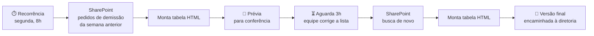

# Offboarding Report Automation — Relatórios de desligamento para RH e Psicologia

Automações em **Power Automate** que transformam as entrevistas de desligamento registradas numa lista do **SharePoint (Microsoft Lists)** em relatórios periódicos por **e-mail (Outlook)**, usados no acompanhamento do RH e da área de Psicologia. Cada relatório sai primeiro como **prévia para conferência** da equipe e, 3 horas depois, como **versão final**, já com as correções feitas na lista, que é encaminhada à diretoria.

## Fluxos

| Fluxo | Frequência | O que reporta |
|-------|-----------|---------------|
| [Desligamento Semanal — Pedido de demissão](fluxos/Desligamento-Semanal-Pedido-de-Demissao) | Segunda, 8h | Entrevistas da semana anterior com tipo de desligamento "Pedido de demissão" |


## O problema

As entrevistas de desligamento ficam registradas numa lista do SharePoint do RH: quem saiu, supervisor, posto, cargo, motivo, se o desligamento poderia ter sido evitado e assim por diante. Para acompanhar os desligamentos, a diretoria precisava de resumos periódicos, e alguém tinha que filtrar a lista, copiar os dados para um e-mail e conferir se nada estava faltando. Era um trabalho repetitivo, e os campos esquecidos só apareciam depois que o relatório já tinha sido enviado.

## Como funciona

Exemplo do fluxo semanal de pedidos de demissão:



1. **Agendamento:** o fluxo roda toda segunda-feira, às 8h (horário de Brasília).
2. **Busca:** consulta a lista com um filtro OData: entrevistas dos últimos 7 dias (de D-8 a D-1) com tipo de desligamento **"Pedido de demissão"**, em ordem de data.
3. **Relatório:** um laço percorre os registros e monta uma tabela HTML com 16 colunas: funcionário, RE, data de admissão, supervisor, posto, cargo, data da entrevista, se foi recolhido do posto, se arrumou outro emprego, se o operacional deseja reversão, histórico, motivo, descrição, se o desligamento foi evitado, tipo de desligamento e observações.
4. **Prévia:** o relatório é enviado por e-mail à equipe responsável, que confere os dados e completa na lista o que tiver ficado faltando.
5. **Versão final:** 3 horas depois, o fluxo **busca os registros de novo**, para pegar as correções, monta o relatório atualizado e envia a versão que segue para a diretoria.

## Decisões de projeto

- **Prévia antes da versão final:** quem preenche a lista revisa o relatório antes de ele chegar à diretoria. Uma pausa de 3 horas dá tempo de corrigir sem atrasar o envio.
- **Nova consulta, não reenvio:** a versão final não reaproveita a primeira tabela. Ela consulta a lista outra vez, então qualquer correção feita nesse intervalo entra no relatório.
- **Filtro no servidor:** o período e o tipo de desligamento são filtrados na própria consulta ao SharePoint (OData `$filter`), e o fluxo só recebe os registros que interessam.
- **Campos de escolha e Sim/Não legíveis:** colunas de escolha, pessoa e booleanas são convertidas em texto (`Sim`/`Não`, valor da opção) direto nas expressões, para a tabela ficar pronta para leitura.

## Estrutura do repositório

```
pacotes/
└── <Nome-do-fluxo>.zip           ← pacote pronto para importar no Power Automate
fluxos/
└── <Nome-do-fluxo>/              ← o mesmo pacote descompactado, para leitura
    ├── manifest.json             ← recursos e conexões do pacote
    └── Microsoft.Flow/flows/<id>/
        └── definition.json       ← definição do fluxo (gatilho, ações e expressões)
```

## Como usar

1. No Power Automate: **Meus fluxos → Importar → Importar pacote (herdado)** e selecione o `.zip` desejado em `pacotes/`.
2. Na importação, escolha **Criar como novo** e selecione (ou crie) as conexões de **SharePoint** e **Office 365 Outlook**.
3. Depois de importar, abra o fluxo e, nas duas ações **Obter itens**, selecione o seu site e a sua lista (os valores originais foram trocados por `SEU-TENANT`/`SEU-SITE` e `<<PREENCHER>>`).
4. Nas duas ações **Enviar um email (V2)**, coloque os destinatários. Se quiser, mande a versão final direto para a diretoria.
5. A lista precisa ter as colunas usadas no filtro e na tabela: `DatadaEntrevista`, `Tipo de desligamento`, `RE`, `DatadeAdmissão`, `Supervisor1`, `Posto`, `Cargo`, `RecolhidodoPosto`, `Arrumououtroemprego`, `Motivo`, `Discriçãodomotivo`, `DesligamentoEvitado` entre outras (veja `definition.json`). Se os nomes internos forem diferentes, ajuste as expressões.
6. Ative o fluxo.

## Segurança

Os pacotes publicados aqui não têm dados de funcionários, endereços do SharePoint, IDs de listas, do tenant ou de usuários, nem e-mails ou contas de conexão. Todos os valores sensíveis foram substituídos por marcadores.
